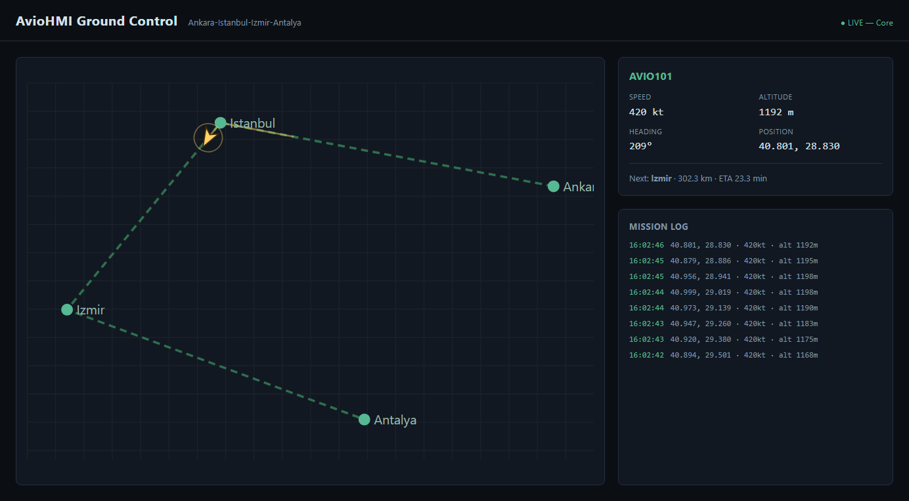
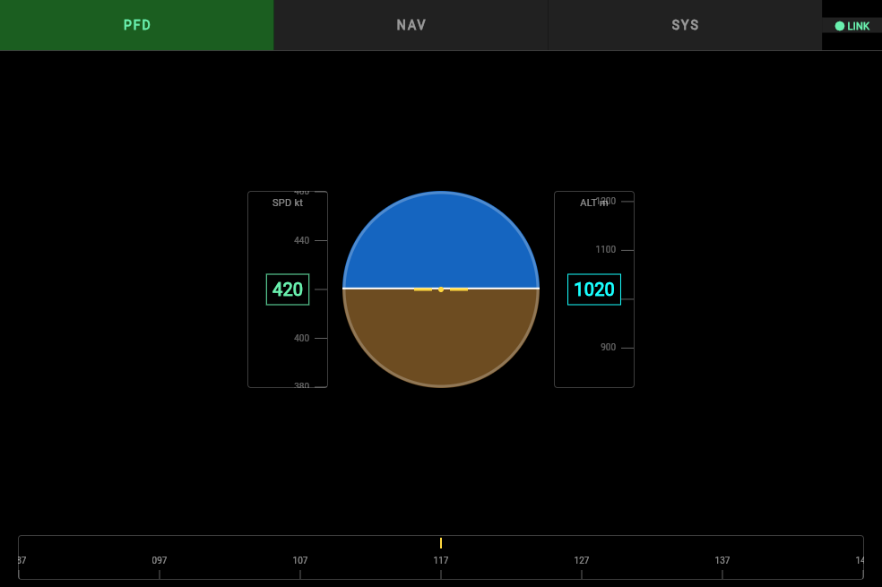
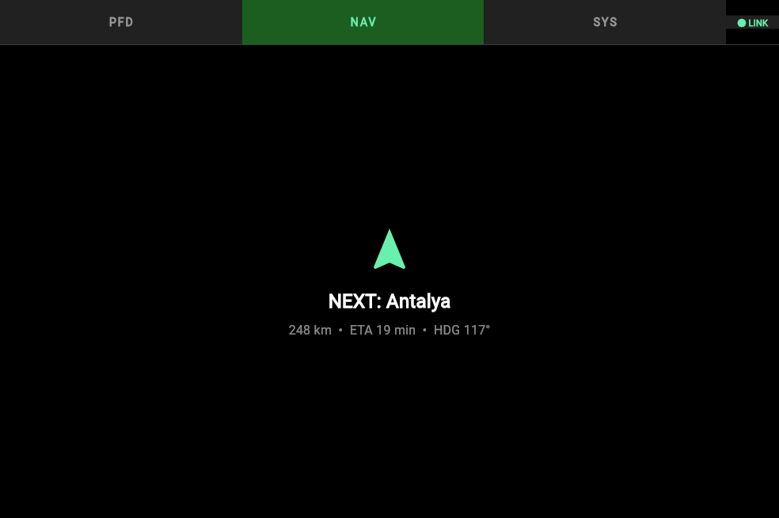

<div align="center">

# AvioHMI

**A full-stack avionics mission-computer & HMI suite**


</div>

AvioHMI is a mission computer and human-machine-interface suite for aircraft
telemetry: a Java "brain" simulates an aircraft flying a route and streams its
position, speed, heading, and attitude live over WebSocket to a touch-screen
cockpit display and a web-based ground-control dashboard, while a separate
CUDA pipeline demonstrates GPU-accelerated sensor image processing. It's built
the way an embedded HMI product would be — layered domain logic, a real
network protocol between components, graceful degradation when a link drops,
and a CI pipeline that builds every module.

## Screenshots

<table>
<tr>
<td width="50%">

**Ground Control** — live route map, telemetry, mission log



</td>
<td width="50%">

**Cockpit MFD** — touch PFD with attitude indicator & tapes



</td>
</tr>
</table>

<details>
<summary>Cockpit MFD — NAV page</summary>



</details>

## Architecture

```
                         ws://localhost:8765
Ground Control (React/TS) ───────────┐
                                       v
                    Mission Computer Core (Java) — avio.app.TelemetryServerApp
                    ├─ domain:    Waypoint, Route, FlightData
                    ├─ data:      Route/Telemetry repositories
                    ├─ service:   EventBus, SensorSimulator, NavigationService
                    └─ transport: WebSocketServer (hand-rolled RFC 6455) + JSON
                                       ^
Cockpit MFD (Flutter, touch) ─────────┘
                         ws://localhost:8765

video-processing/ (CUDA) processes camera/sensor frames independently and
would feed the AR overlay in the Cockpit MFD and Ground Control views.
```

Core is the single source of truth. `TelemetryServerApp` runs the route
simulation and broadcasts every tick as JSON over a plain-JDK WebSocket
server — no external libraries; the handshake, frame reading/writing, and
close sequence are all hand-written in `avio.transport`, since the project
has no Maven/Gradle available. On connect, a client first gets a
`{"type":"route",...}` message with the waypoints, then a `{"type":"telemetry",...}`
message roughly every 500ms with position/speed/heading/roll/pitch and the
distance/ETA to the next waypoint. Roll and pitch are derived server-side
from the heading/altitude delta between ticks (bank angle from turn rate,
pitch from climb rate), so the cockpit's attitude indicator is driven by real
numbers from Core, not a local guess.

Both clients are resilient to Core being unavailable:
- **Ground Control** connects via a `useTelemetrySocket` hook with
  auto-reconnect. If Core isn't reachable within 3s it falls back to a local
  simulator (`mock/telemetryFeed.ts`) so the panel is still demoable
  standalone — a "● LIVE" vs "● OFFLINE PREVIEW" badge shows which is active.
- **Cockpit MFD**'s `FlightState` connects the same way over
  `web_socket_channel`, with its own 2s reconnect loop and a LINK/NO LINK
  indicator in the page-button row.

## Modules

| Module | Stack | What it does |
|---|---|---|
| [`core/`](core) | Java 17, layered architecture | Simulates the aircraft along a route and serves live telemetry over a hand-rolled WebSocket server |
| [`cockpit-mfd/`](cockpit-mfd) | Flutter | Touch multi-function display: PFD (attitude/speed/altitude/heading), NAV, and SYS pages |
| [`ground-control/`](ground-control) | React + TypeScript + Vite | Live route map with flight trail, telemetry panel, and mission log |
| [`video-processing/`](video-processing) | CUDA (nvcc) | GPU-accelerated Sobel edge detection on a synthetic sensor frame |
| [`db/`](db) + `docker-compose.yml` | PostgreSQL + PostGIS | Schema for persisting routes and telemetry history |
| [`.github/workflows/ci.yml`](.github/workflows/ci.yml) | GitHub Actions | Builds and tests Core, Ground Control, and Cockpit MFD on every push |

## Running the connected system

```bash
cd core && ./build.sh && ./serve.sh    # starts ws://localhost:8765
```

Then, in separate terminals:
```bash
cd ground-control && npm install && npm run dev     # open http://localhost:5173
cd cockpit-mfd && flutter pub get && flutter run
```

Ground Control's badge should read "● LIVE" and Cockpit MFD's PFD page should
show the same aircraft moving along the same route.

## Running each module standalone

**Core** (Java, no Maven/Gradle required):
```bash
cd core
./build.sh   # compiles everything into out/
./run.sh     # console demo: runs the simulation once, prints ticks (MissionComputerApp)
./serve.sh   # server: broadcasts the same simulation over ws://localhost:8765, looping forever
./test.sh    # runs the NavigationService smoke test
```

**Cockpit MFD** (Flutter):
```bash
cd cockpit-mfd
flutter pub get
flutter run          # or: flutter run -d windows / -d chrome
flutter test
```

**Ground Control** (React + TypeScript):
```bash
cd ground-control
npm install
npm run dev
```

**Video processing** (CUDA — requires nvcc + an MSVC/gcc host compiler):
```bash
cd video-processing
./build.bat            # Windows: sets up MSVC env and runs nvcc
./edge_detect.exe       # writes input.pgm / output.pgm
```

**Database**:
```bash
docker compose up -d postgres
```

## Roadmap

- Add a GStreamer/FFmpeg pipeline in `video-processing/` feeding real camera
  frames into the CUDA kernel, then compositing the result as an AR overlay.
- Persist routes/telemetry from Core into the PostgreSQL/PostGIS schema in
  `db/init/001_schema.sql` instead of the in-memory repositories.
- Package Cockpit MFD for an embedded Linux + touchscreen target (e.g.
  Raspberry Pi) once Flutter's Linux/embedded toolchain is set up there.

## License

MIT — see [LICENSE](LICENSE).
