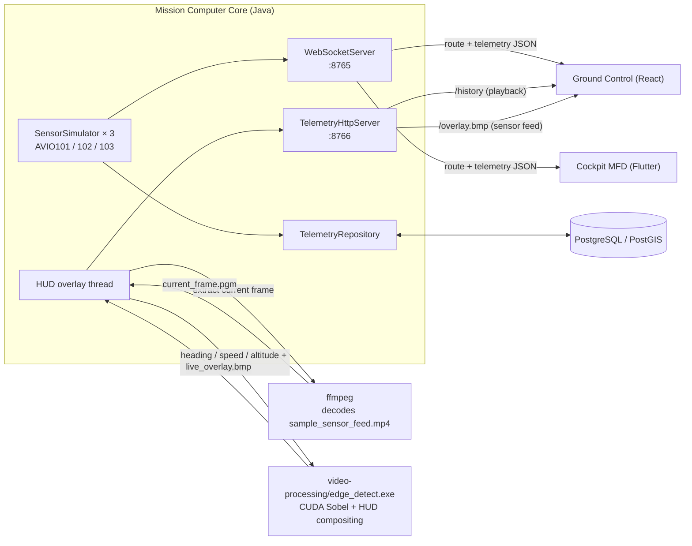

<div align="center">

# AvioHMI

**A full-stack avionics mission-computer & HMI suite**


</div>

AvioHMI is a mission computer and ground-control suite for a small fleet of
simulated aircraft. A Java "brain" flies three aircraft along a shared route
and streams their position, speed, heading, attitude, and fuel state live
over WebSocket to a web-based ground-control dashboard and a touch-screen
cockpit display, while an ffmpeg → CUDA pipeline decodes a real sensor video
and feeds GPU-accelerated Sobel edge detection into a live HUD overlay. It's built the way an embedded
HMI product would be — layered domain logic, a real network protocol between
components, persistence with replay, graceful degradation when a link drops,
and a CI pipeline that builds every module.

## Screenshots


<table>
<tr>
<td width="50%">

**Cockpit MFD** — touch PFD with attitude indicator & tapes


</td>
<td width="50%">

**Cockpit MFD** — NAV page


</td>
</tr>
</table>

## Features

- **Multi-page ops dashboard** — a sidebar + topbar shell (React Router)
  with dedicated Dashboard, Fleet & Map, Playback, Alerts, Sensor Feed, AR
  View, Reports, and Settings pages, all sharing one `TelemetryContext` so
  state (selected aircraft, alert history) survives navigation.
- **AR View (wayfinding)** — a live `getUserMedia` camera feed with an arrow
  composited via canvas that points at a real waypoint's true compass
  bearing, computed from the device's actual GPS position (`Geolocation`) and
  compass heading (`DeviceOrientationEvent`, with the iOS permission-prompt
  path handled). Genuine sensor-driven AR, not a fixed overlay — phone-only,
  since desktop browsers don't expose a compass.
- **Multi-aircraft simulation** — three aircraft (`AVIO101/102/103`) fly the
  same route with distinct personalities: one flies clean, one periodically
  drifts off-course and blips over the speed limit, one is a chronic
  speeder. Click any aircraft on the map or in the fleet list to inspect it.
- **Live alerts** — overspeed, off-course (cross-track distance from the
  planned route), and low-fuel warnings computed from real telemetry and
  surfaced as a banner.
- **Altitude/speed history chart** and a **mission log** for the selected
  aircraft.
- **Waypoint inspector** — click a waypoint on the map for its coordinates
  and altitude.
- **History playback** — telemetry is persisted to PostgreSQL/PostGIS; a
  scrubber lets you rewind and replay any aircraft's recorded flight.
- **CUDA sensor feed** — Core decodes a real frame from a sample sensor video
  with **ffmpeg** every few seconds, runs it through the CUDA Sobel kernel,
  composites live telemetry into a HUD, and Ground Control polls the result —
  a real (if small) multimedia-decode → GPU-processing → HMI-overlay pipeline,
  not just a static test image.
- **Resilient clients** — both Ground Control and Cockpit MFD auto-reconnect
  and degrade gracefully (a local simulator standing in for Ground Control,
  a LINK/NO LINK indicator on the MFD) if Core isn't reachable.
- **Demo operator login** — a UX-only sign-in screen for the "ops center"
  feel (see the security note below).

## Architecture



Core is the single source of truth. `TelemetryServerApp` runs the route
simulation for all three aircraft and broadcasts every tick as JSON over a
plain-JDK WebSocket server — no external libraries; the handshake, framing,
and close sequence are all hand-written in `avio.transport`, since the
project has no Maven/Gradle available. On connect, a client first gets a
`{"type":"route",...}` message with the waypoints, then a
`{"type":"telemetry",...}` message per aircraft roughly every 500ms with
position/speed/heading/roll/pitch/fuel and the distance/ETA to the next
waypoint. Roll and pitch are derived server-side from the heading/altitude
delta between ticks; fuel depletes over each lap and resets when it loops.

Telemetry is written to PostgreSQL/PostGIS when reachable (`docker compose up
-d postgres`); otherwise Core falls back to an in-memory store and says so on
startup. A small `com.sun.net.httpserver.HttpServer` (also JDK-only) exposes
`/history` for playback and `/overlay.bmp`. That overlay comes from a real
pipeline: every few seconds Core shells out to `ffmpeg` to decode the current
frame of `video-processing/assets/sample_sensor_feed.mp4` into a PGM, then
hands that frame to `video-processing/edge_detect.exe`, which runs it through
the CUDA Sobel kernel and composites the lead aircraft's live
heading/speed/altitude into the HUD. If `ffmpeg` isn't on PATH, `avio.transport.FfmpegLocator`
also checks the usual WinGet install location; if neither is found, it falls
back to the synthetic test frame so the feature degrades instead of breaking.

Both clients are resilient to Core being unavailable:
- **Ground Control** connects via a `useTelemetrySocket` hook with
  auto-reconnect. If Core isn't reachable within 3s it falls back to a local
  simulator (`mock/telemetryFeed.ts`) so the panel is still demoable
  standalone — a "● LIVE" vs "● OFFLINE PREVIEW" badge shows which is active.
- **Cockpit MFD**'s `FlightState` connects the same way over
  `web_socket_channel`, with its own 2s reconnect loop and a LINK/NO LINK
  indicator in the page-button row.

> **Security note:** Ground Control's login screen (`components/LoginGate.tsx`)
> is a UX-only demo gate — fixed credentials shown right on the screen, no
> backend check, no hashing, no session token. It exists to give the
> dashboard an "ops center" feel and must not be mistaken for real access
> control.

## Modules

| Module | Stack | What it does |
|---|---|---|
| [`core/`](core) | Java 17, layered architecture | Simulates 3 aircraft along a route; serves live telemetry (WebSocket), history (HTTP), and the HUD overlay (HTTP) |
| [`cockpit-mfd/`](cockpit-mfd) | Flutter | Touch multi-function display: PFD (attitude/speed/altitude/heading), NAV, and SYS pages |
| [`ground-control/`](ground-control) | React + TypeScript + Vite + React Router | Multi-page ops dashboard: Dashboard, Fleet & Map, Playback, Alerts, Sensor Feed, AR View, Reports, Settings |
| [`video-processing/`](video-processing) | CUDA (nvcc) + ffmpeg | Decodes a real sample video frame, runs GPU Sobel edge detection, composites a live-telemetry HUD |
| [`db/`](db) + `docker-compose.yml` | PostgreSQL + PostGIS | Schema for routes/telemetry, backing history playback |
| [`.github/workflows/ci.yml`](.github/workflows/ci.yml), [`.gitlab-ci.yml`](.gitlab-ci.yml), [`Jenkinsfile`](Jenkinsfile) | GitHub Actions, GitLab CI, Jenkins | Equivalent build/test pipelines for whichever CI system a team already runs |

## Running the connected system

```bash
docker compose up -d postgres          # optional but recommended: enables /history playback
cd core && ./build.sh && ./serve.sh    # starts ws://localhost:8765 and http://localhost:8766
```

Then, in separate terminals:
```bash
cd ground-control && npm install && npm run dev     # open http://localhost:5173, sign in as operator/aviohmi
cd cockpit-mfd && flutter pub get && flutter run
```

Ground Control's badge should read "● LIVE" and Cockpit MFD's PFD page should
show one of the same aircraft moving along the same route.

## Running each module standalone

**Core** (Java, no Maven/Gradle required):
```bash
cd core
./build.sh   # compiles everything into out/
./run.sh     # console demo: runs one aircraft once, prints ticks (MissionComputerApp)
./serve.sh   # server: broadcasts 3 aircraft over ws://localhost:8765 + http://localhost:8766, looping forever
./test.sh    # runs the NavigationService smoke test
```

**Cockpit MFD** (Flutter):
```bash
cd cockpit-mfd
flutter pub get
flutter run          # or: flutter run -d windows / -d chrome
flutter test
```

**Ground Control** (React + TypeScript):
```bash
cd ground-control
npm install
npm run dev
```

**Video processing** (CUDA — requires nvcc + an MSVC/gcc host compiler; ffmpeg optional):
```bash
cd video-processing
./build.bat                                          # Windows: sets up MSVC env and runs nvcc
./edge_detect.exe 250 460 1500 out.bmp               # synthetic test frame
./edge_detect.exe 250 460 1500 out.bmp frame.pgm     # process a real frame instead (any P5 PGM)

# extract a real frame from the bundled sample video first:
ffmpeg -y -ss 3.0 -i assets/sample_sensor_feed.mp4 -vframes 1 -pix_fmt gray frame.pgm
```

**Database**:
```bash
docker compose up -d postgres   # exposes 5433 on the host — 5432 is often already taken locally
```

## Roadmap

- Feed the CUDA pipeline from a live camera/RTSP source via ffmpeg instead of
  the bundled sample video, for a true real-time sensor feed.
- Package Cockpit MFD for an embedded Linux + touchscreen target (e.g.
  Raspberry Pi) once Flutter's Linux/embedded toolchain is set up there.
- Replace the demo login gate with real authentication if this ever needs to
  be more than a portfolio piece.

## Development process

Built iteratively, one demoable increment per sprint — see
[docs/SPRINTS.md](docs/SPRINTS.md) for the sprint-by-sprint backlog and
retro notes, reconstructed from the actual git history.

## License

MIT — see [LICENSE](LICENSE).
